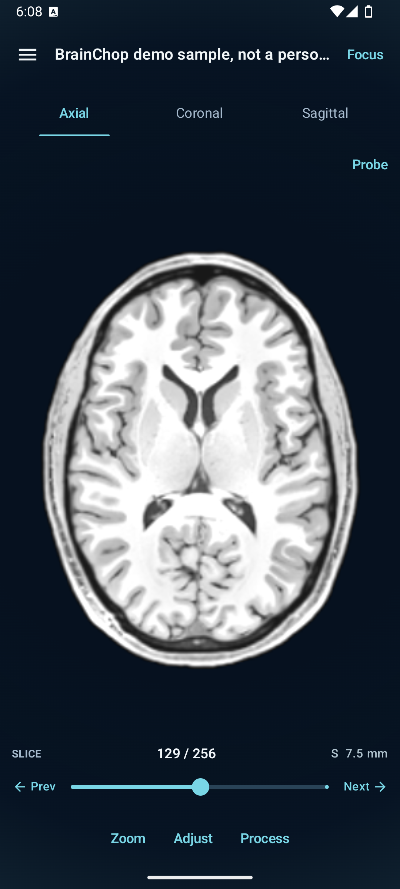
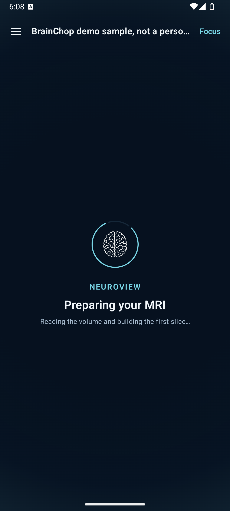
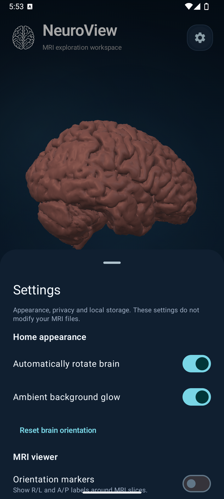
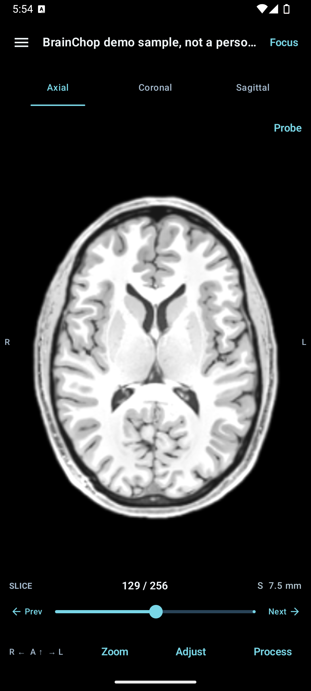
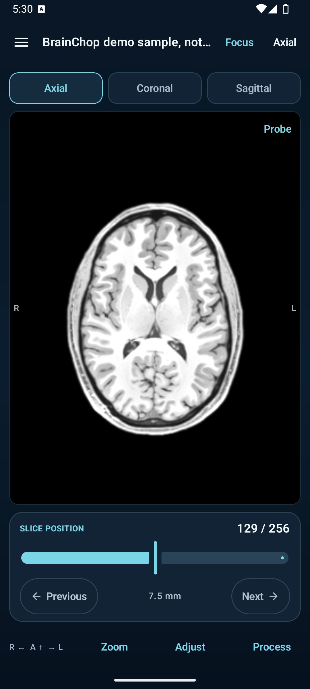
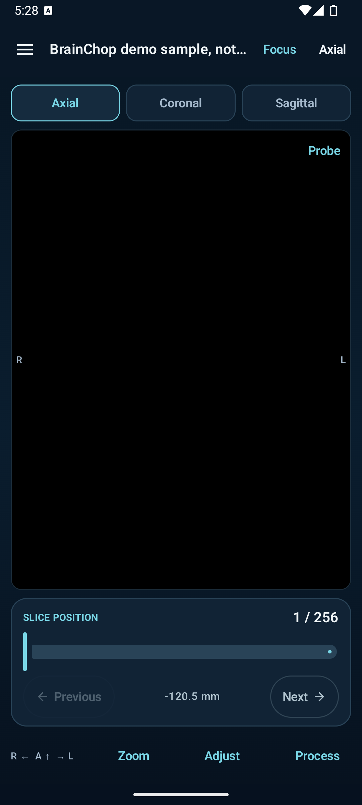
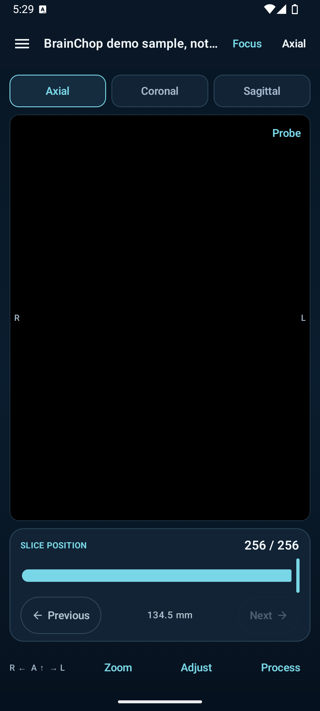

# MRI viewer slider review

Reviewed in the Android emulator using the local **BrainChop demo sample, not a personal scan**.

## Updated layout

The viewer keeps axial, coronal, and sagittal choices in one compact, one-tap tab row. The duplicate plane button and slide-out plane panel are removed. The slice control no longer sits in a large outlined card: the slice count and coordinate share a slim header, the track and handle are compact, and small previous/next buttons flank the slider. Those buttons retain 48 dp touch targets, and the slider announces its slice and coordinate to accessibility services.

The viewer uses one unframed deep-navy canvas. A faint cyan/blue perimeter glow fades inward across the screen instead of forming separate top and bottom bands. The MRI viewport is transparent, and near-black rendered pixels blend with the canvas so the slice image does not leave a rectangular edge; source voxel data is unchanged. The initial image scale is 130% of fit to give the brain more of the available display.

Plane and slice controls remain easy to reach. Their labels are more readable, the lower actions sit together rather than spreading across the width, and the slice buttons keep 48 dp touch targets. Orientation markers start hidden; the Home Settings sheet has a saved “Orientation markers” switch for R/L and A/P labels.

The loading state now carries NeuroView branding, with the app logo, an accent progress ring, and a short status message over the same blue glow treatment.

## Slider observations

The midpoint at 129/256 shows anatomy. The first and last positions in this demo show black panels, so the screenshots capture the volume boundaries as well as the useful midpoint. Those blank edges are a property of this sample and its coverage; the viewer keeps the original slice range intact instead of silently skipping positions.

## Orientation labels

For axial and coronal views, **R on screen-left and L on screen-right is the radiological convention**: it shows the patient as if viewed face-to-face. Neurological display convention places the patient’s left on screen-left instead, so viewers can differ. The radiological convention is a normal display choice, not by itself evidence that the source scan was stored or altered as a mirror image. [FMRIB’s MRI primer describes the radiological and neurological conventions](https://www.fmrib.ox.ac.uk/primers/appendices/anatomy.pdf).

NeuroView’s MPR renderer samples the volume through its NIfTI RAS+ affine and deliberately maps patient-right to the left side of the axial/coronal display ([renderer](../../../app/src/main/java/com/marcusfunt/neuroview/mri/MprRenderer.kt)). That reorients the displayed view; it does not rewrite the source voxel data. The labels still depend on correct orientation metadata. NeuroView already warns when orientation metadata is unavailable, but a present affine cannot prove that the source metadata itself is correct.

## Suggestions

- Keep the plane tabs and slice readout visible in the normal viewer; the Focus mode remains available for a larger image-only view.
- Keep compact graphics paired with forgiving touch areas and explicit accessibility labels.
- Keep the marker preference independent from the image orientation; show or hide labels without flipping or changing the scan.
- If black boundary slices are confusing in future samples, consider a small “outside acquired coverage” hint only after the renderer can distinguish no sampled voxels from measured black data.
